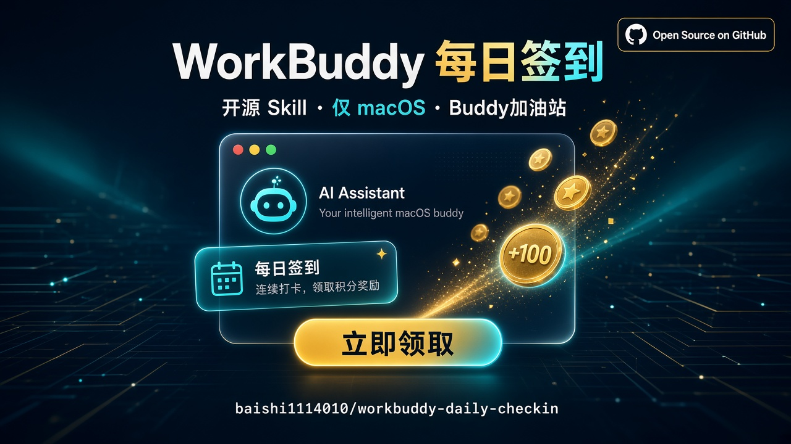

# WorkBuddy 每日签到领积分（macOS Skill）




自动领取 WorkBuddy 客户端「Buddy加油站」每日免费积分（每日约 100 通用积分）。面向 Cursor / WorkBuddy 等支持 Agent Skill 的客户端使用。

> **仅支持 macOS。** Windows 暂不提供。

## 功能

- 激活 WorkBuddy，模拟点击「立即领取」
- System Events 权限失效时自动走 Quartz 绕行（头像菜单 → Buddy加油站）
- 输出 JSON + 截图，供 Agent 视觉核验「领取成功 / 今日已签到」

## 安装

```bash
# 克隆到 WorkBuddy skills 目录（路径可按你的客户端约定调整）
mkdir -p ~/.workbuddy/skills
git clone https://github.com/baishi1114010/workbuddy-daily-checkin.git \
  ~/.workbuddy/skills/workbuddy-daily-checkin

chmod +x ~/.workbuddy/skills/workbuddy-daily-checkin/scripts/claim_checkin.sh
```

若使用 Cursor 等其他客户端，把仓库放到该客户端约定的 skills 目录即可。

## 权限（一次性）

在 **系统设置 → 隐私与安全性** 中：

1. **辅助功能**：勾选运行本脚本的宿主（如 Terminal / Cursor / WorkBuddy）
2. **屏幕录制**：同上（用于截图核验）
3. **自动化**（可选）：允许相关应用控制 System Events；不行时脚本会自动走 Quartz 绕行

## 手动跑一次

```bash
bash ~/.workbuddy/skills/workbuddy-daily-checkin/scripts/claim_checkin.sh
```

成功时会打印一行 JSON，例如 `status` 为 `clicked`，并带上 `bubble_shot` / `full_shot` 路径。用 Agent 看图确认「今日已签到」或「领取成功」即可。

在对话里也可以说：「签到」「领积分」「Buddy加油站」等触发词，让 Agent 按 `SKILL.md` 执行。

## 目录结构

```
workbuddy-daily-checkin/
├── SKILL.md                 # Agent 执行说明
├── README.md
├── LICENSE
└── scripts/
    └── claim_checkin.sh     # macOS 签到脚本
```

## 注意

- 需已安装并**登录** WorkBuddy 桌面客户端
- 执行时不要移动鼠标；多显示器/不同分辨率下点击偏移可能需微调
- 若弹出「限时加购」等购买卡，通常表示今日已签过，勿再点
- 本工具通过 UI 自动化完成领取，非官方 API；使用风险自负，请遵守 WorkBuddy 用户协议

## License

MIT
